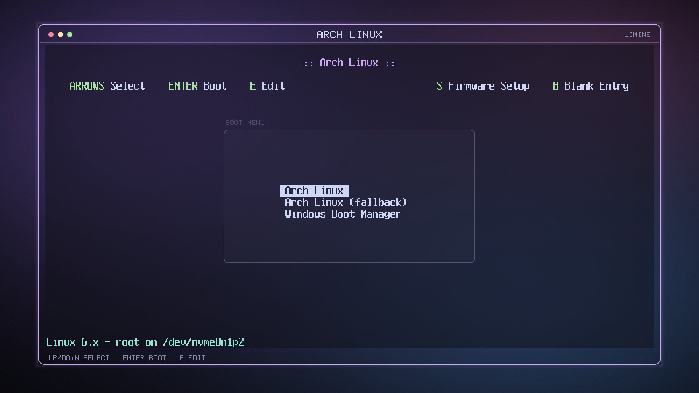
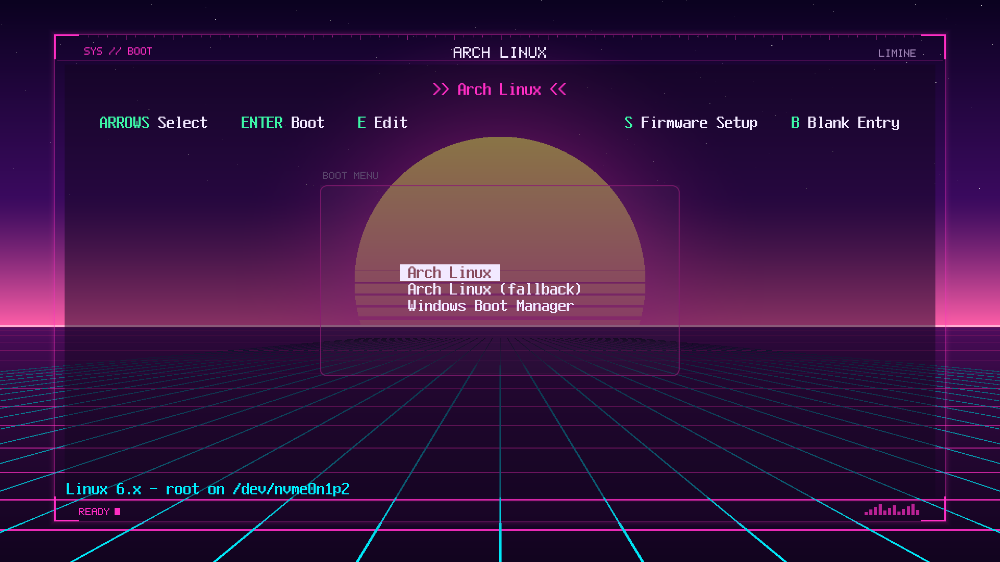

# limine-theme

A script that themes the [Limine](https://limine-bootloader.org) boot menu. GRUB has hundreds of themes, Limine has basically none, so I made a few.




Both shots are real Limine (v9) running in QEMU, not mockups.

## What it actually does

Limine doesn't have a theme engine. The menu is a plain text screen and you can't move things around or add icons. So the script does two things:

1. Writes a block of colour/margin/font options into your `limine.conf`.
2. Generates a wallpaper with a window frame drawn into it, lined up with where Limine puts its text. That's where the "UI" comes from.

The wallpapers are generated with Python's standard library, so there's nothing to install besides bash and python3.

## Usage

```
git clone https://github.com/Spont-427/limine-theme
cd limine-theme
sudo bash limine-theme.sh
```

With no arguments you get a picker. Left/right to browse, Enter to install. It finds your `limine.conf` by itself (it asks if it finds more than one).

Other things you can do:

```
bash limine-theme.sh list                        # all themes
bash limine-theme.sh preview nord                # preview in the terminal
sudo bash limine-theme.sh -t synthwave -y        # no questions
sudo bash limine-theme.sh -t glass --ui hud      # pick the frame style
sudo bash limine-theme.sh -t nord --title MYPC   # text in the title bar
sudo bash limine-theme.sh -t nord --variants 3   # 3 wallpapers, random one each boot
sudo bash limine-theme.sh remove                 # undo everything
```

`bash limine-theme.sh --help` has the rest.

**If your screen isn't 1920x1080**, pass `--screen WIDTHxHEIGHT`. The frame is drawn pixel-for-pixel so it needs to know. Or use `--ui none` to skip the frame and just get colours and a wallpaper.

## Themes

catppuccin-mocha, nord, gruvbox, tokyo-night, rose-pine, dracula, solarized-dark, synthwave, neon-city, matrix, crt-amber, crt-green, gameboy, old-bios, glass, minimal.

Colours for the named ones are the usual published palettes (Catppuccin, Nord, Gruvbox, Tokyo Night, Rosé Pine, Dracula, Solarized). The wallpapers are original.

## What it touches

Everything goes in one block at the top of `limine.conf`, between `# >>> limine-theme >>>` and `# <<< limine-theme <<<`. If you already had lines like `wallpaper:` or `term_palette:`, they get commented out with a `#[limine-theme]` prefix, and `remove` puts them back. A backup of the config is saved to `limine-theme/backups/` next to it (last 5 kept). Wallpapers go in `limine-theme/` next to your config.

On CachyOS (and anything using `limine-entry-tool`) the block sits above the generated entries, and that part of the file is left alone when entries get regenerated.

## Things to know

- I only tested against Limine v9 binaries in QEMU. Newer versions should look the same, but I haven't confirmed it. If something's off, open an issue and include `limine --version` and your `limine.conf`.
- Limine 12 switched the branding/help colour options from 0-7 indices to hex. The script reads `limine --version` to decide; override with `--colour-mode hex` or `index`.
- Secure Boot: Limine silently skips wallpapers without a hash, so the script adds hashes when it sees Secure Boot is on. If you enrolled a config hash you'll need to re-enroll it after changing the config.
- NixOS regenerates `limine.conf` on rebuild, so use the `boot.loader.limine.style` options instead. The script refuses to run there unless you pass `--force`.
- Only the new `limine.conf` format works (Limine 9+), not the old `limine.cfg`.
- The centre "boot menu" panel is sized for about 11 entries.
- The panel transparency byte is documented one way in Limine's docs and another way in the CachyOS wiki. I used `80` (50%) so it reads the same either way. `--panel` changes it if yours looks off.

## License

MIT. Not affiliated with the Limine project.
